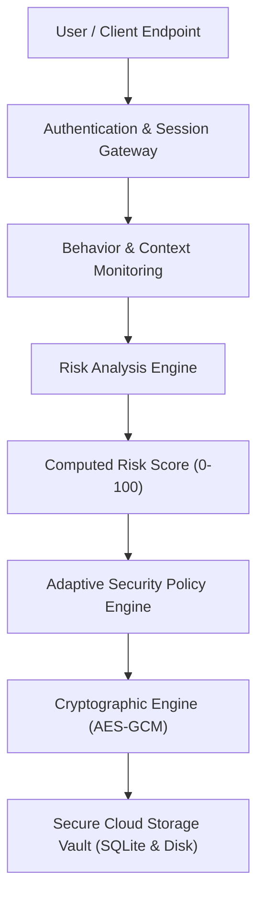
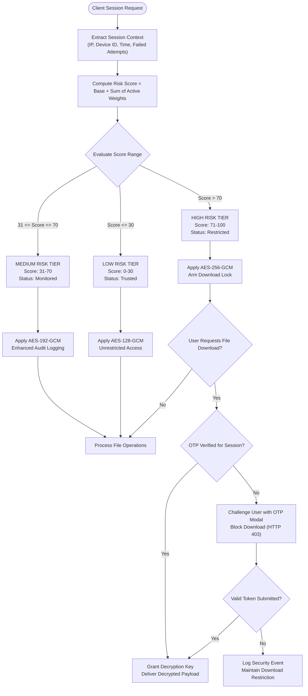

# CloudCrypt: Risk-Adaptive Encryption Framework for Secure Cloud Storage

[](#)
[](#)
[](#)
[](#)

> **CloudCrypt** is a modern full-stack cybersecurity web application that dynamically evaluates user session risk and contextual threat signals to adaptively modulate the encryption strength and access governance of files stored in the cloud.

---

## 1. Project Overview

Cloud storage platforms typically adopt a static security posture: data is either uniformly encrypted with a fixed cipher (e.g., standard AES-256 at rest) or protected under static access controls regardless of whether an access request originates from a trusted corporate intranet or an anomalous IP address operating under suspicious behavioral velocity.

**CloudCrypt** introduces an **Adaptive Security Framework** that dynamically calculates an aggregate **Risk Score (0–100)** based on real-time threat vectors (unrecognized device fingerprints, off-hours access, abnormal IP geo-telemetry, and brute-force indicators). As the risk score escalates, the system dynamically scales cryptographic overhead, cipher key lengths (**AES-128 ➔ AES-192 ➔ AES-256**), and mandates **Step-Up Two-Factor Authentication (OTP)** before permitting sensitive file downloads.

---

## 2. Problem Statement

Conventional cloud security architectures suffer from two fundamental extremes:
1. **Under-Protection (Static Baseline)**: High-risk or compromised sessions are granted the same data access privileges as trusted sessions until an account is manually revoked.
2. **Over-Protection (Usability Bottleneck)**: Enforcing military-grade encryption, heavy key derivation overhead, and constant multi-factor challenges across benign, low-risk operations creates severe computational latency and degrades user experience.

There is a critical need for an **intelligent, context-aware security orchestration engine** that balances computational efficiency and cryptographic assurance in real-time.

---

## 3. Proposed Solution

CloudCrypt addresses this challenge by establishing an end-to-end **Risk-Adaptive Encryption Pipeline**:
- **Continuous Session Telemetry**: Monitors behavioral anomalies including IP reputation, device fingerprints, time-of-day access, and authentication velocity.
- **Dynamic Heuristic Scoring**: Evaluates detected vectors into a normalized Risk Score between $0$ and $100$.
- **Adaptive Cryptographic Envelope**: Newly uploaded files are sealed with AES in Galois/Counter Mode (GCM) using keys derived through PBKDF2 with dynamic bit lengths:
  - **Low Risk (0–30)**: **AES-128-GCM** (High performance, standard commercial assurance, normal access).
  - **Medium Risk (31–70)**: **AES-192-GCM** (Enhanced assurance, heightened telemetry audit logging).
  - **High Risk (71–100)**: **AES-256-GCM** (Maximum cryptographic resilience, download actions gated behind mandatory OTP verification).
- **Interactive Risk Simulator**: A purpose-built demonstration console allowing academic evaluators to inject threat anomalies and witness immediate cryptographic policy transitions.

---

## 4. System Architecture

The following diagram illustrates the flow of session telemetry, threat scoring, cryptographic derivation, and encrypted storage in CloudCrypt:



---

## 5. Risk-Based Decision Flowchart

The adaptive decision logic evaluating incoming sessions and gating cryptographic actions is represented below:



---

## 6. Risk Scoring & Mathematical Formulation

The dynamic risk score $R(t)$ at any given timestamp $t$ is calculated using a bounded linear heuristic model:

$$R(t) = \min\left(100, \; R_{\text{base}} + \sum_{i=1}^{n} w_i \cdot \mathbb{I}(f_i)\right)$$

Where:
- $R_{\text{base}} = 15$ represents the baseline noise inherent to network sessions.
- $w_i$ is the pre-configured risk weight assigned to telemetry factor $f_i$.
- $\mathbb{I}(f_i) \in \{0, 1\}$ is an indicator function representing whether threat factor $i$ is detected.

### Telemetry Factor Weights

| Factor Identifier | Threat Description | Category | Weight ($w_i$) |
| :--- | :--- | :--- | :---: |
| `new_device` | Unrecognized browser canvas or hardware fingerprint | Device Identity | **+20** |
| `unknown_ip` | Egress from unwhitelisted corporate subnet / alien ASN | Network | **+25** |
| `unusual_time` | Access initiated during off-peak hours (02:00–05:00) | Temporal | **+15** |
| `failed_logins` | $\ge 3$ consecutive bad authentication challenges | Authentication | **+30** |
| `suspicious_download` | Abnormal file extraction frequency or batch operations | Data Access | **+25** |
| `unusual_location` | Tor exit node, commercial proxy, or anomalous geolocation | Geo-Telemetry | **+35** |

---

## 7. Adaptive Encryption Logic

CloudCrypt utilizes **AES in Galois/Counter Mode (AES-GCM)**, an authenticated encryption standard (AEAD) recognized by NIST SP 800-38D.

| Risk Level | Score Range | Symmetric Cipher | Key Size | Auth Tag | Operational Profile | Access Control |
| :---: | :---: | :---: | :---: | :---: | :--- | :--- |
| **LOW** | $0 - 30$ | **AES-128-GCM** | 128 bits (16 B) | 128 bits | Hardware-accelerated, sub-millisecond | Full, normal file operations |
| **MEDIUM** | $31 - 70$ | **AES-192-GCM** | 192 bits (24 B) | 128 bits | Elevated enterprise cryptanalytic defense | Stepped-up auditing & telemetry |
| **HIGH** | $71 - 100$ | **AES-256-GCM** | 256 bits (32 B) | 128 bits | Post-quantum resistant symmetric level | **Mandatory 2FA/OTP Gating** |

### Cryptographic Lifecycle
1. **Key Derivation (PBKDF2-HMAC-SHA256)**: Each uploaded file generates a unique 16-byte cryptographically secure salt. A key of the exact required bit length (128, 192, or 256 bits) is derived across 100,000 iterations.
2. **Initialization Vector (IV/Nonce)**: A unique 96-bit random nonce is generated per encryption operation to prevent replay attacks and IV reuse vulnerabilities.
3. **AEAD Authentication Tag**: A 128-bit MAC tag is appended to verify both ciphertext confidentiality and authenticated integrity upon decryption.
4. **Digest Hashing**: Dual SHA-256 checksums are calculated (pre-encryption plaintext digest vs. post-encryption ciphertext digest) for audit verification.

---

## 8. Technology Stack

- **Backend**:
  - **Python 3.12** with **Flask 3.1**
  - **Cryptography (pyca/cryptography 41.0+)**: Authenticated AES-GCM primitives, PBKDF2HMAC, and SHA-256
  - **SQLite 3**: Lightweight ACID storage for user credentials, file ledgers, and audit events
  - **Flask-CORS**: Cross-origin communication for development and decoupled architectures
- **Frontend**:
  - **React 18** (Modern functional components with custom hooks)
  - **Tailwind CSS**: Dark cybersecurity design system with glowing neon borders and custom HUD elements
  - **Lucide React**: Vector cybersecurity iconography
  - **Vite 5**: Next-generation lightning-fast build tool
- **Architecture**:
  - Clean modular structure with segregated API routes, crypto engine, and risk engine
  - Unified single-server deployment: Flask serves the compiled React single-page application and all REST APIs simultaneously.

---

## 9. Setup & Execution Instructions

### Prerequisites
- Python 3.10+ (Standard Python runtime)
- Node.js 18+ (Only required if modifying/rebuilding frontend source files)

### Quick Start (Single Command)

Launch the entire full-stack application using the provided startup script:

```bash
chmod +x run.sh
./run.sh
```

The gateway will automatically initialize the database, seed realistic demo files, and serve the application on:
👉 **`http://127.0.0.1:5000`**

### Manual Step-by-Step Setup

#### 1. Backend Setup
```bash
# Navigate to project root
python3 -m venv venv
source venv/bin/activate

# Install backend dependencies
pip install -r backend/requirements.txt

# Run backend test suite
python backend/test_suite.py

# Start Flask API server
python backend/app.py
```

#### 2. Frontend Setup (Optional for Development)
```bash
cd frontend
npm install
npm run build    # Compiles assets into frontend/dist for Flask
# OR
npm run dev      # Runs Vite live-reloading dev server on port 5173
```

---

## 10. Academic Demonstration & Review Credentials

For B.Tech Project-Based Learning (PBL) evaluations and viva demonstrations, the database is pre-seeded with realistic records:

| Parameter | Default Value | Notes |
| :--- | :--- | :--- |
| **Login URL** | `http://127.0.0.1:5000` | Unified web console |
| **Operator Email** | `secops@cloudcrypt.io` | Lead Security Architect |
| **Passphrase** | `cloudcrypt123` | SHA-256 hashed in database |
| **Demo 2FA / OTP Code** | `749215` | Use when prompted for high-risk files |
| **Preloaded Files** | 5 files | `research_paper.pdf`, `database_backup.zip`, etc. |

### Demonstration Flow for Evaluators
1. **Login Portal**: Click the 1-click **"Low Risk"** preset or log in with credentials.
2. **Dashboard Overview**: Observe the **Radial Risk Score Gauge (20/100 - LOW)** and **Adaptive Security Status** indicating AES-128 protection.
3. **Secure Storage**: Browse the files table. Download `research_paper.pdf` (downloads immediately because session is trusted).
4. **Cryptographic Inspection**: Click the **Eye icon** on any file to view the PBKDF2 salt, 96-bit nonce, 128-bit authentication tag, and SHA-256 integrity hash.
5. **Risk Simulator**:
   - Navigate to the **"Risk Simulator"** page.
   - Toggle **"Unknown IP (+25)"**, **"Multiple Failed Logins (+30)"**, and **"Unusual Geographic Location (+35)"**.
   - Notice the score dynamically escalate to **90 / 100 (HIGH RISK)** and the response switch to **AES-256 + OTP Lock**.
   - Click **"Apply To Active Session"**.
6. **Adaptive Defense in Action**:
   - Return to **Secure Storage**. Notice the banner now declares active AES-256 allocation.
   - Upload any document — it will be encrypted on the fly with AES-256-GCM.
   - Attempt to download `database_backup.zip` or the newly uploaded file. The system enforces a **Two-Factor Challenge Modal**.
   - Enter `749215` (or click "Auto-Fill") to unlock and authorize decryption!
7. **Security Activity**: Inspect the chronological audit trail showing timestamps, risk calculations, and cipher elevation events.
8. **Analytics**: Review file distribution by risk level and cipher bit strength.

---

## 11. Future Scope & Roadmap

1. **Post-Quantum Cryptography (PQC)**: Integrate NIST-standardized post-quantum algorithms (ML-KEM / Kyber for key encapsulation and ML-DSA / Dilithium for digital signatures).
2. **Zero-Knowledge Proofs (ZKP)**: Implement zero-knowledge range proofs for user location and device attestation without exposing raw client telemetry.
3. **Behavioral Biometrics**: Incorporate continuous keystroke dynamics and mouse movement cadence into the real-time risk scoring engine.
4. **Decentralized Storage (IPFS / Filecoin)**: Interface the adaptive encryption layer with decentralized storage networks for censorship-resistant disaster recovery.

---

## 12. Project License
Developed as an academic research prototype for Project-Based Learning (PBL) in Cybersecurity. Open-source under the MIT License.
